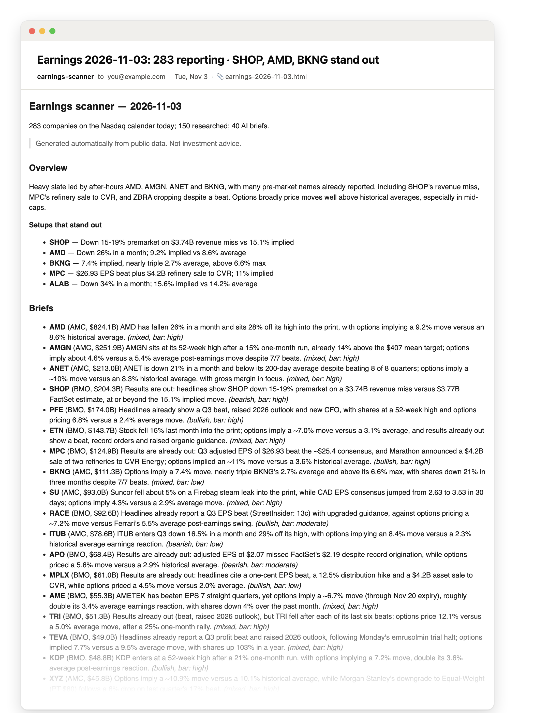
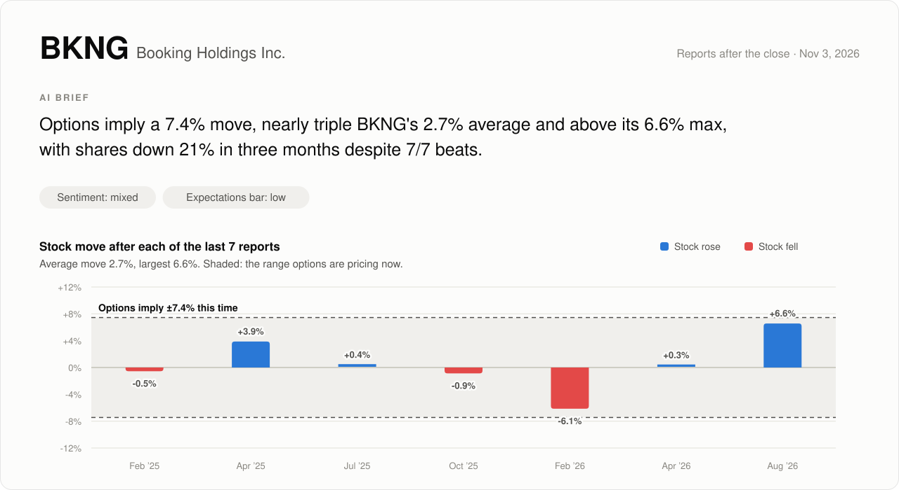
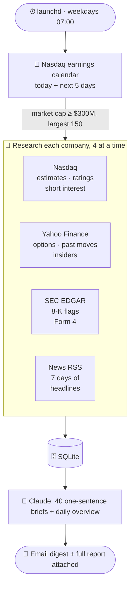

<picture>
  <source media="(prefers-color-scheme: dark)" srcset="docs/assets/banner-dark.svg">
  
</picture>

<p align="center">
  
  
  
  
  
</p>

Every weekday morning, earnings-scanner reads the [Nasdaq earnings calendar](https://www.nasdaq.com/market-activity/earnings), researches every sizable company reporting that day, asks Claude for a one-sentence brief on each, and emails you the result. Everything it collects is kept in SQLite for later analysis.

> Generated from public data for research. Not investment advice.

## What lands in your inbox

A short digest in the email body: the day's overview, the setups that stand out, one-sentence briefs and a summary table. The full report, with per-company detail on expectations, price, positioning, analysts, filings and headlines, is attached as an HTML page.

<p align="center">
  
</p>

## Every company gets a brief

Claude reads everything collected for a company and writes the one thing that matters going into the print, tagged with sentiment and how high the bar is. The report puts it next to the numbers behind it, such as how far the stock moved after past reports against what options are pricing now.

<picture>
  <source media="(prefers-color-scheme: dark)" srcset="docs/assets/brief-card-dark.svg">
  
</picture>

<sub>Real output from the 2026-11-03 run.</sub>

## How it works



1. **Calendar.** Nasdaq's calendar for today and the next five weekdays, plus the previous session again to capture actual EPS and the surprise.
2. **Research.** Each company above $300M market cap (largest 150 on busy days) is looked up across four free sources. Each source can fail on its own without stopping the run.
3. **Store.** Raw payloads, normalized metrics, headlines and filings go into `data/earnings.db`.
4. **Brief.** Claude writes a one-sentence brief for the 40 largest companies above $2B and a short overview ranking the day's standout setups.
5. **Deliver.** The report is written to `reports/YYYY-MM-DD.md` and emailed. If a run fails, a short failure email goes out instead.

## What it collects

| Source | Data |
|---|---|
| **Nasdaq** (`api.nasdaq.com`, the JSON behind the earnings page) | Calendar: time (BMO/AMC), market cap, fiscal quarter, consensus EPS, # of estimates, last year's EPS; next 5 weekdays stored too; the previous session re-fetched for actual EPS and % surprise. Per company: quote, profile, quarterly/annual EPS forecast with high/low and 4-week revisions up/down, last 4 surprises, analyst rating and price targets, institutional ownership and position changes, short interest (Nasdaq-listed only) |
| **Yahoo Finance** (`yfinance`) | Returns (5d to 1y), distance from 52w high, realized vol, valuation and margins, **options-implied earnings move** (ATM straddle on the first expiry after the report), put/call open interest, **historical post-earnings moves** (last 8 reports), revenue estimate, EPS trend (current vs 7/30/60/90 days ago), upgrades/downgrades (90d), insider buys/sales (90d), short % of float and month-over-month change |
| **SEC EDGAR** | Filings from the last 45 days, with flags for notable 8-K items (restatements, officer changes, impairments, restructurings, cyber incidents, ...) and Form 4 counts |
| **News** (Google News and Yahoo Finance RSS) | Headlines from the last 7 days, deduplicated |
| **Claude** (optional) | Per-company brief: one sentence on the setup, tagged with sentiment and how high the bar is. Plus a daily overview ranking the setups that stand out |

## Quick start

```bash
git clone https://github.com/LukasUser/earnings-scanner.git && cd earnings-scanner
python3 -m venv .venv
.venv/bin/pip install -r requirements.txt
cp .env.example .env   # fill in ANTHROPIC_API_KEY, the email settings and optionally SEC_USER_AGENT
./scripts/install_launchd.sh
```

That's it: the scanner now runs every weekday at 07:00. If the Mac is asleep then, launchd runs it when it wakes.

## Usage

```bash
.venv/bin/python -m earnings_scanner run                      # today
.venv/bin/python -m earnings_scanner run --date 2026-11-04    # a specific day
.venv/bin/python -m earnings_scanner run --symbols AAPL,MSFT  # just these
.venv/bin/python -m earnings_scanner run --limit 10 --no-brief --no-email
.venv/bin/python -m earnings_scanner report --date 2026-10-30 # re-render from the DB
.venv/bin/python -m earnings_scanner email                    # (re)send today's report
```

<details>
<summary><b>Outputs</b></summary>

- `reports/YYYY-MM-DD.md`: the daily report
- An email with a short digest (overview, one-sentence briefs, the reporters table) and the full report attached as an HTML page. If a run fails, a short failure email is sent instead
- `data/earnings.db`: SQLite with tables `earnings_calendar`, `snapshots` (raw payload per source per day), `facts` (normalized metrics), `news`, `filings`, `briefs`, `runs`
- `logs/`: run logs

</details>

<details>
<summary><b>Schedule</b></summary>

`scripts/install_launchd.sh` installs a launchd agent that runs on weekdays at the time in `config.toml` `[schedule]` (default 07:00). If the Mac is asleep at that time, launchd runs the job when it wakes up.

```bash
./scripts/install_launchd.sh               # install or update (re-run after changing the time)
launchctl kickstart gui/$(id -u)/com.earnings-scanner.daily   # run now
./scripts/install_launchd.sh --uninstall
```

</details>

<details>
<summary><b>Email</b></summary>

Sent through Gmail SMTP. Set these in `.env`, which is git-ignored, so neither address nor password ends up in the repo:

```
EMAIL_TO=you@example.com
SMTP_USER=you@gmail.com          # the Gmail account that sends
SMTP_PASSWORD=abcd efgh ijkl mnop # an app password, not your Google password
```

Gmail needs an **app password**: turn on 2-Step Verification, then go to Google Account → Security → App passwords (or https://myaccount.google.com/apppasswords) and create one. Test it with `.venv/bin/python -m earnings_scanner email`. To turn email off, set `[email] enabled = false` in `config.toml`.

</details>

<details>
<summary><b>Configuration and Claude cost</b></summary>

`config.toml` controls the market-cap cutoffs, how many companies to research, worker counts, the Claude model (`claude-opus-5-5`) and effort, and whether the overview is written. Peak earnings days list 300 to 600 companies, so research is limited to market cap ≥ $300M and briefs to ≥ $2B by default.

**Claude cost:** one-sentence briefs on Opus 5.5 at medium effort use roughly 8k input and under 1k output tokens each, about half what the earlier long-form briefs cost (~$0.09). `brief.max_briefs = 40` caps each day at the 40 largest companies, so a run costs at most about $2–3 including the overview, even in peak earnings season (when 150–250 companies qualify). The overview still covers every researched company; the ones past the cap are ranked on their data and headlines. Each run logs its token usage. To cut cost further, lower `max_briefs`, raise `brief.min_market_cap`, lower `effort`, or switch `model` to `claude-sonnet-5-5` (about half the price).

</details>

## Caveats

- Nasdaq's and Yahoo's endpoints are unofficial and can change or rate-limit without notice. Each source fails on its own, so one failure doesn't stop the run, and `facts.data_errors` records what was missing. Check their terms of use and keep the request volume modest.
- Implied moves come from delayed quotes. Before the open, bid/ask can be stale, so the straddle may be off.
- Headlines are titles only. The scanner does not fetch full articles.

<sub>The images above are generated from a real run with `.venv/bin/python docs/make_assets.py --date 2026-11-03 --symbol BKNG`.</sub>
